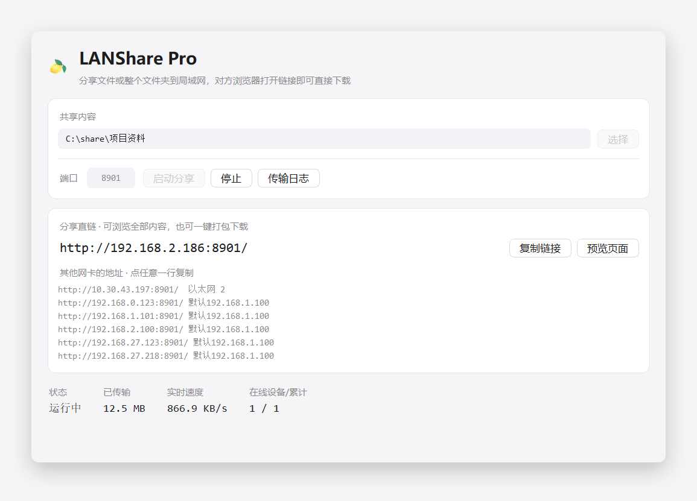
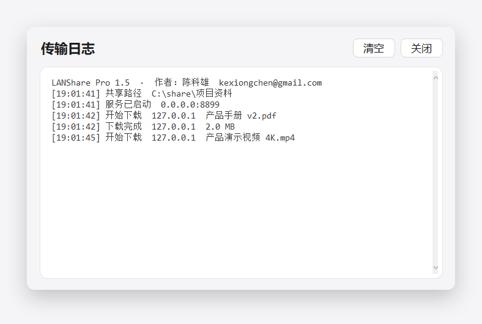
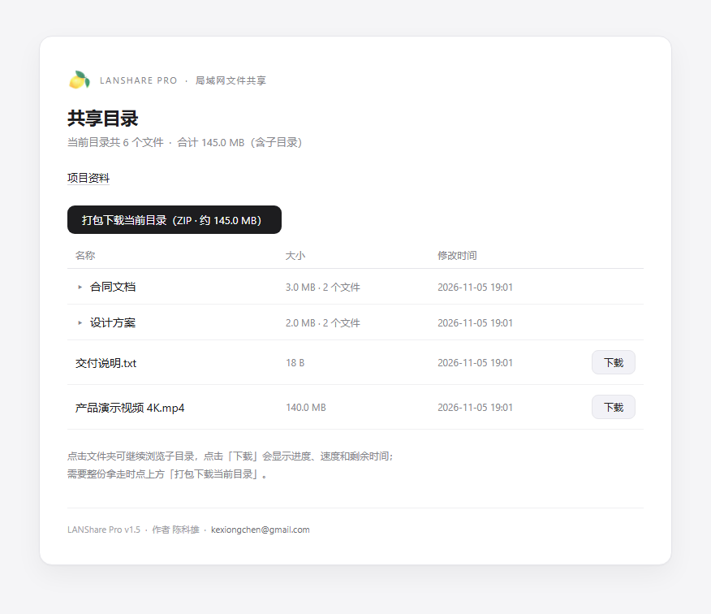

# LANShare Pro

[简体中文](./README.md) | **English**

> Share any file or a whole folder as a direct HTTP link on your LAN — a single portable Windows app.

[](./LICENSE)
[](#compatibility)
[](#run-from-source)

Author: **Kexiong Chen** · <kexiongchen@gmail.com> · GitHub: [@maomaodashetou](https://github.com/maomaodashetou)

---

## What is it

Sending a large file across the office LAN usually means uploading to a cloud drive, zipping
everything, or asking the other side to install an FTP client. LANShare Pro reduces it to three
steps: **pick → share → send the link**. The receiver only needs a browser: browse folders,
download single files with resume support, or grab a whole directory as one ZIP.

Nothing leaves your local network. No cloud, no accounts, no third-party services.

## Features

- **File or folder mode** — share a single file as a direct link, or a whole directory tree to browse.
- **Folder sizes at a glance** — each directory shows its total size and file count, and the ZIP button shows
  the estimated archive size.
- **Download progress** — clicking download opens a floating card with percentage, speed and ETA.
- **Multi-NIC friendly** — every adapter (Ethernet / Wi-Fi / virtual) is listed with its name; click a row to
  copy that URL.
- **Direct download links** — `http://your-ip:port/download`, `Range` requests supported, works with IDM / Thunder.
- **One-click ZIP** — every directory page has "Download this folder (ZIP)", streamed on the fly with no temp file on disk.
- **Chinese-friendly filenames** — `Content-Disposition` per RFC 5987, so non-ASCII names survive.
- **Live stats** — transferred bytes, current speed and online devices; details in a separate log window.
- **Clean exit** — closing the window stops the listener and frees the port immediately.
- **Portable** — one exe with the Python runtime and assets bundled, no installation required.
- **UI** — Apple-style light cards and rounded controls, high-DPI aware.

## Screenshots







## Quick start

1. Download `LANSharePro.exe` from [Releases](https://github.com/maomaodashetou/LANSharePro/releases).
2. Double-click → **Select** a file or folder → set a port (8899 by default) → **Start sharing**.
3. Click **Copy link** and send the address to anyone on the same network.

> On first run Windows will ask about the firewall. Allow it on **Private networks**, otherwise
> other devices cannot reach the port.

## Web endpoints

| Path | Description |
| --- | --- |
| `/` | Single-file mode: download page; folder mode: directory listing |
| `/download` | Direct link for single-file mode |
| `/download?p=relative/path` | Download one file from the shared folder (Range supported) |
| `/browse?p=relative/path` | Browse a sub-directory |
| `/zip?p=relative/path` | Stream the directory as a ZIP archive |

## Compatibility

| OS | Status | Notes |
| --- | --- | --- |
| Windows 11 | ✅ | Verified |
| Windows 10 | ✅ | Verified |
| Windows 8.1 | ✅ | Expected to work (same build) |
| Windows 7 SP1 | ✅ | 64-bit only; UCRT (KB2999226) recommended |
| Windows 7 32-bit | ❌ | 64-bit build only |

The app writes nothing to the registry and creates no config files. It can run from a USB stick.

## Run from source

Standard library only — no `pip install` needed:

```bash
# Python 3.8 or newer
python LANSharePro.py
```

## Build your own

Use **Python 3.8 + PyInstaller 5.13.x** if you need Windows 7 support; newer Python/PyInstaller
combinations are fine for Windows 10/11 only.

```bash
pip install pyinstaller==5.13.2

pyinstaller --noconfirm --onefile --windowed ^
  --name LANSharePro ^
  --icon assets/logo.ico ^
  --add-data "assets;assets" ^
  --version-file version_info.txt ^
  LANSharePro.py
```

The output is `dist/LANSharePro.exe`. `--icon` and `--version-file` control the exe icon and the
author/copyright shown in file properties; `--add-data` bundles `assets/`, which is located at
runtime via `sys._MEIPASS` (no absolute paths).

## Project layout

```
LANSharePro.py      main program: HTTP server + Tkinter UI
version_info.txt    exe version resource (author / copyright / product)
assets/             logo.ico (exe icon), logo_64.png (UI & web logo)
docs/images/        screenshots used by the README
LICENSE             MIT
```

## Security notes

- **No authentication.** Anyone who can reach the port can download the shared content — use it on
  trusted networks and stop it when you are done.
- Path traversal is blocked: every relative path is resolved with `realpath` and must stay inside
  the shared root (`../`, absolute paths and out-of-tree symlinks return 404).
- The server never binds to the public internet by itself and performs no uploads or cloud sync.

## FAQ

**The other side cannot open the link.**
Check that both devices are on the same subnet, that the firewall allows the port, and that
"AP isolation" is disabled on the Wi-Fi network.

**Port already in use?**
Pick another port (e.g. 9000) and start again; the error dialog tells you when the port is taken.

**Both Ethernet and Wi-Fi are connected, but only one side can open the page.**
The adapters sit on different subnets, so each side needs its own address — the app lists one URL per
adapter under "其他网卡的地址". If the address is right but the page still does not load, it is usually
Windows Firewall: Wi-Fi is often classified as *Public*, while inbound is only allowed on *Private*.

1. Set that Wi-Fi to *Private*: Settings → Network & Internet → Wi-Fi → network → Network profile → Private;
2. Or allow the app for all profiles from an elevated PowerShell:
   `netsh advfirewall firewall add rule name="LANShare Pro" dir=in action=allow program="D:\path\to\LANSharePro.exe" profile=any`

Some corporate/public Wi-Fi also enables AP isolation, which blocks device-to-device traffic entirely.

**Does the ZIP download support resume?**
Single-file downloads do. The ZIP is generated on the fly, so an interrupted archive must restart.

**Antivirus flags the exe.**
PyInstaller one-file executables are occasionally false-positived. The full source is here — you
can rebuild it yourself with the command above.

## Changelog

- **1.5.2** — online-device counter (the web page heartbeats every 20 s, so a phone that opens the page shows
  as 1 online); removed the "copy all" button, click a single row to copy.
- **1.5.1** — all adapter addresses are listed (no truncation), click a row to copy it, "copy all" button,
  and the window grows to fit the list.
- **1.5** — per-folder size and file count, estimated ZIP size, floating download card with progress /
  speed / ETA, and every NIC listed with its adapter name (physical adapters first).
- **1.4** — Apple-style UI (rounded cards/buttons/inputs), light borders, author info in the log
  header and web footer, exe version resource; rebuilt with Python 3.8 for Windows 7 support.
- **1.3** — unified button style, single "Select" entry, logo on the web pages, icon cache fix.
- **1.2** — separate log window, vertical address list, streamed ZIP download.
- **1.1** — folder sharing, port released on exit, application icon.
- **1.0** — single-file direct link, Range resume, live speed stats.

## Contributing

Issues and pull requests are welcome. Please:

1. stick to the Python standard library (no extra dependencies);
2. keep Windows 7 compatibility (avoid 3.9+ syntax);
3. keep UI strings in Chinese and comments concise.

## License

[MIT License](./LICENSE) © 2026 Kexiong Chen
