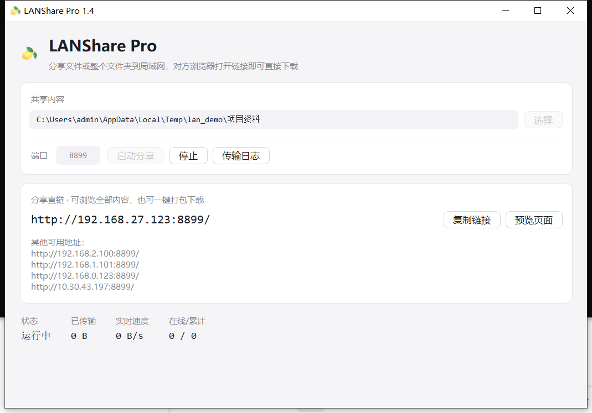
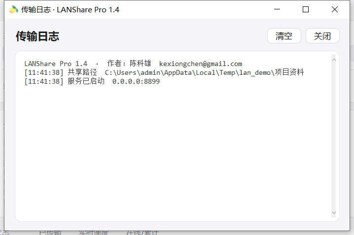

# LANShare Pro

[简体中文](README.md) | [English](README.en.md)

> 把任意文件或整个文件夹，一键分享成局域网 HTTP 直链 —— Windows 单文件免安装工具。

[](./LICENSE)
[](#兼容性)
[](#从源码运行)

作者：**陈科雄** · 邮箱：<kexiongchen@gmail.com> · GitHub：[@maomaodashetou](https://github.com/maomaodashetou)

---

## 这是什么

在同一局域网里传大文件，通常要么登录网盘、要么打包压缩、要么教对方装 FTP 客户端。
LANShare Pro 把这件事压缩成三步：**选文件 → 起服务 → 发链接**。
对方只要浏览器，打开链接就能浏览目录、单个下载或整包拿走，支持断点续传。

不压缩、不上传云端、不依赖任何第三方服务，数据只在你自己的局域网里流转。

## 功能特性

- **文件 / 文件夹两种共享模式**：选一个文件即生成直链；选文件夹则可逐级浏览全部子目录。
- **浏览器直链下载**：`http://你的IP:端口/download`，支持 `Range` 断点续传，可交给 IDM / 迅雷等工具。
- **一键打包下载**：浏览页每个目录都有「打包下载当前目录（ZIP）」，边压缩边推送，不在磁盘生成临时 zip。
- **中文文件名友好**：按 RFC 5987 输出 `Content-Disposition`，中文文件落地不乱码。
- **实时状态**：已传输流量、实时速度、在线/累计连接数一目了然；传输明细在独立的「传输日志」窗口。
- **退出即释放**：关闭窗口立刻停止监听、释放端口，不留后台进程。
- **免安装**：单个 exe，内置 Python 运行时与界面资源，拷到任何 Windows 机器都能直接跑。
- **界面**：Apple 风格浅色卡片 + 圆角按钮，白底黑字，高分屏 DPI 适配。

## 界面预览






## 快速开始

1. 下载 [Releases](https://github.com/maomaodashetou/LANSharePro/releases) 里的 `LANSharePro.exe`（或自行打包，见下文）。
2. 双击运行 → 点「选择」→ 选择文件或文件夹 → 填端口（默认 8899）→ 点「启动分享」。
3. 点「复制链接」，把地址发给同网段的人即可。

> 首次启动时 Windows 会弹防火墙提示，请勾选「专用网络」并允许，否则局域网内其他设备无法访问。

## 网页端说明

| 地址 | 作用 |
| --- | --- |
| `/` | 单个文件：下载落地页；文件夹：目录浏览 |
| `/download` | 单文件模式的直链地址 |
| `/download?p=相对路径` | 下载目录中的某个文件（支持 Range） |
| `/browse?p=相对路径` | 浏览子目录 |
| `/zip?p=相对路径` | 把该目录整体打包成 zip 下载（流式） |

## 兼容性

| 系统 | 状态 | 说明 |
| --- | --- | --- |
| Windows 11 | ✅ | 已验证 |
| Windows 10 | ✅ | 已验证 |
| Windows 8.1 | ✅ | 理论可用（同构建） |
| Windows 7 SP1 | ✅ | 需 64 位系统，建议已安装 UCRT（KB2999226）补丁 |
| Windows 7 32 位 | ❌ | 当前仅提供 64 位构建 |

程序不写入注册表、不落地配置文件，关闭即走，整个 exe 可放在 U 盘或共享盘上运行。

## 从源码运行

只依赖 Python 标准库，无需 `pip install`：

```bash
# Python 3.8 及以上
python LANSharePro.py
```

## 自行打包

需要 Windows 环境。为了兼容 Windows 7，请使用 **Python 3.8 + PyInstaller 5.13.x**；
只考虑 Windows 10/11 时可用更新版本的 Python 与 PyInstaller。

```bash
pip install pyinstaller==5.13.2

pyinstaller --noconfirm --onefile --windowed ^
  --name LANSharePro ^
  --icon assets/logo.ico ^
  --add-data "assets;assets" ^
  --version-file version_info.txt ^
  LANSharePro.py
```

产物在 `dist/LANSharePro.exe`。其中：

- `--icon` 与 `--version-file` 决定 exe 图标与「属性 → 详细信息」里的作者/版权信息；
- `--add-data` 把 `assets/`（logo 图标）打进 exe，运行时通过 `sys._MEIPASS` 相对定位，不依赖绝对路径。

## 目录结构

```
LANSharePro.py      主程序：HTTP 服务 + Tkinter 界面
version_info.txt    exe 版本资源（作者 / 版权 / 产品名）
assets/             logo.ico、logo.png、logo_64.png
docs/images/        README 用截图
LICENSE             MIT 许可证
```

## 安全说明

- 本工具**没有登录鉴权**，任何能访问该端口的人都能下载共享内容，请只在可信局域网内使用，用完即关。
- 共享根目录之外的文件不可访问：所有相对路径都会做 `realpath` 校验，`../`、绝对路径、符号链接越界一律 404。
- 不监听公网、不做端口映射，不涉及任何上传或云端同步。

## 常见问题

**Q：对方打不开链接？**
先确认在同一网段；再检查防火墙是否放行了该端口；部分企业无线开启了 AP 隔离，设备之间无法互访。

**Q：端口被占用？**
换一个端口（如 9000）重新启动即可，错误提示会直接指出端口占用。

**Q：打包下载能断点续传吗？**
单文件下载支持续传；打包下载是实时压缩流，中断后需要重新下载。

**Q：会被杀毒软件误报吗？**
PyInstaller 单文件程序偶有误报，源码完全公开，可自行用上面的命令打包核对。

## 更新日志

- **1.4**：Apple 风界面（圆角卡片/按钮/输入框）、按钮浅色描边、作者信息写入日志首行与网页页脚、exe 版本资源；改用 Python 3.8 构建以兼容 Windows 7。
- **1.3**：统一按钮风格、「选择」合并文件/文件夹入口、网页增加 logo、修复图标缓存问题。
- **1.2**：传输日志独立窗口、备选地址竖排、文件夹一键打包下载（流式 ZIP）。
- **1.1**：支持分享整个文件夹、退出释放端口、应用图标。
- **1.0**：单文件直链分享、Range 断点续传、实时速率统计。

## 贡献

欢迎提交 Issue 与 Pull Request。提交前请保证：

1. 只使用 Python 标准库，避免引入额外依赖；
2. 保持 Windows 7 兼容（不要使用 3.9+ 语法）；
3. 界面文案保持中文，代码注释简洁。

## 许可证

[MIT License](./LICENSE) © 2026 陈科雄

---

## English Summary

LANShare Pro is a tiny Windows utility that turns any file or folder into a direct HTTP download
link on your local network. Pick a file or directory, choose a port, click share — anyone on the
same LAN can open the link in a browser to browse, download (with resume support) or grab the whole
folder as a streamed ZIP. Single portable exe, no installation, no cloud, no external tools.

Author: **Kexiong Chen** · <kexiongchen@gmail.com>
